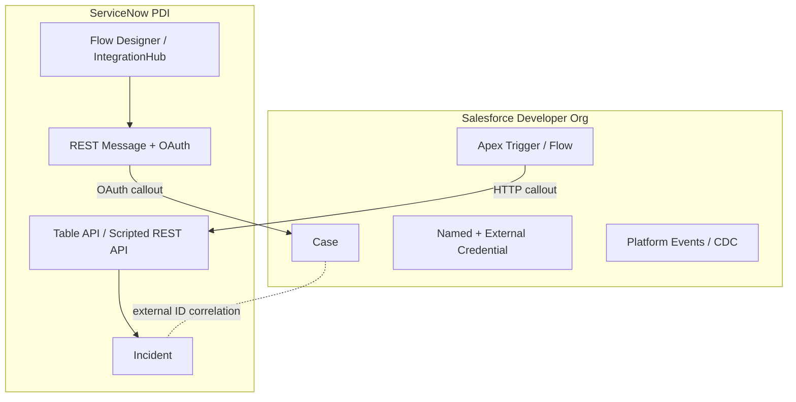

# 0. Overview, Architecture & Core Concepts

## Purpose

This lab teaches you to stand up two **free** SaaS developer environments and make them talk to each other:

- **ServiceNow Personal Developer Instance (PDI)** — a full, production-like platform for learning.
- **Salesforce Developer Edition org** — a full Sales Cloud org for learning.

The goal is a **proof-of-concept (PoC) integration** that synchronizes a business object across the two platforms — the canonical example is **Salesforce Case ⇄ ServiceNow Incident** (a support ticket that lives in both systems and stays in sync).

## Core integration concepts (read these first)

### 1. Integration direction

| Type | Description | Example in this lab | Key challenges |
|------|-------------|---------------------|----------------|
| **One-way (unidirectional)** | Data flows only A → B | Salesforce Case creates a ServiceNow Incident | Simple, low risk of loops |
| **Two-way (bidirectional)** | Data flows both directions | Case ⇄ Incident sync | Infinite loops, conflicts, last-writer-wins |

### 2. Field ownership / System of Record

Even in a two-way sync, **each field has one owner**. The owner is the only system allowed to change that field on a normal sync; the other system reads it.

| Field | Owned by | Rationale |
|-------|----------|-----------|
| Subject / short_description | Salesforce | CRM-side capture |
| Priority / Impact / Urgency | Salesforce | Triage at intake |
| Account / Contact links | Salesforce | Relationship data lives in CRM |
| **State / Resolution / Assignment group** | ServiceNow | Fulfilment & ops |
| Work notes / resolution notes | ServiceNow | Agent-side notes |
| Description | Shared (controlled) | Last-writer-wins with timestamp + source flag |

> **Rule:** the owner writes; the non-owner reads. Without this rule, every sync becomes a tug-of-war.

### 3. Manual edits vs integration writes

Humans edit records *after* sync. The next integration write must not blindly overwrite them.

| Technique | How it works |
|-----------|--------------|
| Source flag | A `u_synced_from_integration = true` field; the outbound trigger skips records it just received |
| Timestamp compare | Compare `sys_updated_on` (SN) vs `LastModifiedDate` (SF); only push if the *source* is newer |
| Ownership map | Integration always wins for *owned* fields; human edits on *non-owned* fields are preserved until the owner updates them |
| Separate fields | Keep `description` (customer-facing) distinct from `work_notes` (agent-facing) so they never collide |

### 4. Common integration methods

| Method | Direction | Code | Notes |
|--------|-----------|------|-------|
| **ServiceNow Table API** (`/api/now/table/incident`) | Inbound | None | Standard CRUD; easiest |
| **ServiceNow Scripted REST API** | Inbound | JS | Custom validation/transforms |
| **ServiceNow Outbound REST Message + Business Rule** | Outbound | Little | SN pushes data out |
| **Salesforce Flow + HTTP Callout** | Outbound | None | Low-code callout |
| **Salesforce Apex Callout** | Outbound | Apex | More control |
| **IntegrationHub Spokes** | Outbound | None | Pre-built, often needs paid subscription — not ideal for free labs |

## Architecture

## Learning objectives

1. Provision and navigate a PDI and a Developer org.
2. Distinguish out-of-box from custom methods, and one-way from two-way.
3. Choose the right method per direction and use case.
4. Configure secure credentials (Named/External Credentials, OAuth) without hardcoding secrets.
5. Build a bidirectional, loop-safe sync with correlation IDs and field ownership.
6. Validate end-to-end and document a test plan.

## How to use this lab

- **Climb the levels** (1 → 4). Each level builds on the last.
- **Do, don't just read** — every level has "Do it" and "Verify" blocks.
- **⚠️ flags** mark release-dependent facts to confirm on your own instance (free-tier entitlements drift over time).

## Non-goals

- No production deployment — developer instances only.
- No paid IntegrationHub Enterprise subscription — spokes are an *option*, not a requirement.
- No third-party middleware / iPaaS (MuleSoft, Boomi, Workato).
- No real customer data — synthetic records only.
