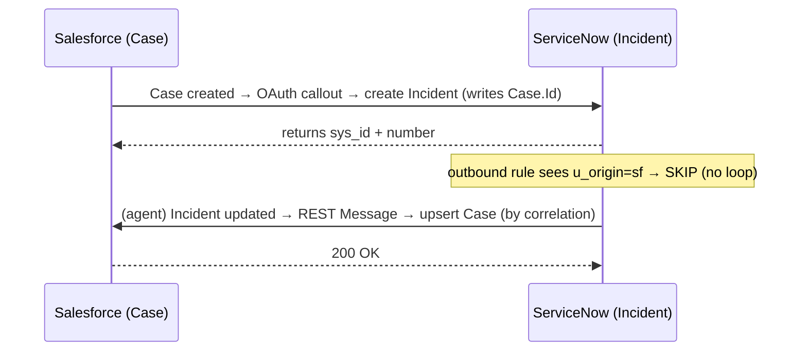

# 5. Level 4 — Bidirectional Sync, Field Ownership & OAuth

This is where the lab gets real. Two directions, OAuth 2.0 (not Basic Auth), a **field-ownership map**, and a **loop guard**. If you master this level you can build a production-shaped integration.

## 5.1 The four building blocks

| # | Building block | Where |
|---|----------------|-------|
| A | OAuth credentials (no hardcoded secrets) | Salesforce **Connected App** + ServiceNow **Application Registry** |
| B | Salesforce → ServiceNow | **Named Credential** + Apex/Flow (upgrade Level 2 to OAuth) |
| C | ServiceNow → Salesforce | **REST Message + OAuth profile**, invoked by Business Rule/Flow |
| D | Correlation + loop guard + field ownership | External-ID fields + origin flag on **both** records |

## 5.2 Field ownership map (decide this before coding)

| Field | Owner (writes) | Other system (reads) |
|-------|----------------|----------------------|
| Subject / short_description | Salesforce | ServiceNow |
| Priority / Impact / Urgency | Salesforce | ServiceNow |
| Account / Contact link | Salesforce | ServiceNow |
| State / Resolution code | ServiceNow | Salesforce |
| Assignment group / Assignee | ServiceNow | Salesforce |
| Work notes / Resolution notes | ServiceNow | Salesforce |
| Description | Shared | Last-writer-wins with timestamp + source flag |

**Manual edits:** a human edit on a *non-owned* field survives until the owner updates it; a human edit on an *owned* field is either ignored on next sync or logged as a conflict (choose and document which).

## 5.3 Block A — OAuth setup

### A1. Salesforce Connected App (ServiceNow is the OAuth *client*)

Setup → App Manager → **New Connected App**:

1. Name: `ServiceNow PDI Integration`.
2. Enable **OAuth Settings**.
3. Callback URL: `https://login.salesforce.com/services/oauth2/success` is fine for token-based flows.
4. OAuth scopes: **`api`** and **`refresh_token, offline_access`** (so ServiceNow can hold a refresh token).
5. Save, then note the **Consumer Key** and **Consumer Secret**.

> ⚠️ The Consumer Secret is a **secret** — it goes into a credential record, never into Git.

### A2. ServiceNow OAuth provider (Salesforce is the OAuth *client*)

All → **Application Registry** → New → **Create an OAuth API endpoint for external clients**:

1. Name: `Salesforce Integration`.
2. Grant type: **Client Credentials** (machine-to-machine) is cleanest for server-to-server.
3. Note the **Client ID** and **Client Secret**.

### A3. Integration users (least privilege)

- **ServiceNow:** a dedicated user (e.g. `sf_integration`) with only the roles needed to read/write `incident`.
- **Salesforce:** a dedicated **Integration User** (profile = "API Only System Integrations" or a minimal custom profile).

## 5.4 Block B — Salesforce → ServiceNow (OAuth callout)

Upgrade Level 2's Basic Auth to OAuth:

1. Named Credential → **New**, Identity Type **Named Principal**, Authentication Protocol **OAuth 2.0** (client credentials), with the Client ID/Secret from A2.
2. Create a **Remote Site Setting** for `https://YOUR-PDI.service-now.com` (required for Apex callouts; Flow HTTP callouts via Named Credential don't need it but Apex does).
3. Apex callout (or an invocable action called from Flow):

```apex
public class IncidentSyncService {
    public static String createIncident(Case c) {
        Http http = new Http();
        HttpRequest req = new HttpRequest();
        req.setEndpoint('callout:ServiceNow/api/now/table/incident');
        req.setMethod('POST');
        req.setHeader('Content-Type', 'application/json');
        req.setHeader('Accept', 'application/json');
        Map<String, Object> body = new Map<String, Object>{
            'short_description' => c.Subject,
            'description' => c.Description,
            'u_correlation_id' => c.Id,
            'u_origin' => 'salesforce'
        };
        req.setBody(JSON.serialize(body));
        HttpResponse res = http.send(req);
        if (res.getStatusCode() >= 200 && res.getStatusCode() < 300) {
            return res.getBody();
        }
        throw new CalloutException('ServiceNow error ' + res.getStatusCode() + ': ' + res.getBody());
    }
}
```

> `callout:ServiceNow` is the Named Credential — token + URL are injected by the platform; the class holds **no secret**.

```apex
trigger CaseToIncident on Case (after insert, after update) {
    for (Case c : Trigger.new) {
        if (c.Origin == 'ServiceNow Sync') { continue; }   // loop guard
        IncidentSyncService.createIncident(c);
    }
}
```

## 5.5 Block C — ServiceNow → Salesforce (REST Message + OAuth)

### ServiceNow OAuth client profile (outbound to Salesforce)

All → **Application Registry** → New → **Connect to a third party OAuth Provider**:

1. Name: `Salesforce OAuth`.
2. Authorization/Token URLs from A1's Connected App.
3. Client ID/Secret = the Connected App Consumer Key/Secret.
4. Scopes: `api refresh_token offline_access`.
5. **Get OAuth Token** to fetch and cache an access token.

### REST Message

System Web Services → **REST Message** → New:

1. Name: `Salesforce Case API`.
2. Endpoint: `https://<MyDomain>.my.salesforce.com/services/data/v60.0/sobjects/Case`.
3. Authentication type: **OAuth 2.0**, profile = `Salesforce OAuth`.

Add a **POST** (and a **PATCH** for updates) HTTP method with a JSON body and `Content-Type: application/json`.

### Invoke from a Business Rule (or Flow)

```javascript
(function executeRule(current, previous) {
    // Loop guard: skip when this incident came FROM Salesforce
    if (current.u_correlation_id && current.u_origin === 'salesforce') {
        return;
    }
    var rm = new sn_ws.RESTMessageV2('Salesforce Case API', 'upsert_case');
    rm.setStringParameterNoEscape('Subject', current.short_description);
    rm.setStringParameterNoEscape('Description', current.description);
    rm.setStringParameterNoEscape('Correlation_Id__c', current.getUniqueValue());
    var response = rm.execute();
    var code = response.getStatusCode();
    if (code < 200 || code >= 300) {
        gs.error('Salesforce call failed ' + code + ': ' + response.getBody());
    }
})(current, previous);
```

> A **Flow Designer** flow (trigger = incident created/updated) invoking the same REST Message is the no-code equivalent.

## 5.6 Block D — correlation & loop prevention (the substance)

Both records carry correlation + origin:

| Field | Salesforce (Case) | ServiceNow (Incident) |
|-------|-------------------|-----------------------|
| Correlation | `Correlation_Id__c` = SN `sys_id` | `u_correlation_id` = SF Case `Id` |
| Origin flag | `Origin = 'ServiceNow Sync'` | `u_origin = 'salesforce'` |

**Rules:**

1. When A creates B, it writes **its own ID** into B's correlation field.
2. B's outbound trigger checks its **origin flag** — if it came from A, **skip** (this breaks the loop).
3. When B updates A, it includes A's stored correlation ID so A **updates** (not duplicates).

## 5.7 The happy path



## 5.8 End-to-end playbook (condensed)

1. **SF → SN create:** create a Case (`Origin = Manual`) → one Incident, `u_correlation_id` = Case Id.
2. **Loop guard:** after step 1, confirm no Case is created back in Salesforce.
3. **SN → SF create:** create an Incident as a normal user → one Case, `Correlation_Id__c` = Incident sys_id.
4. **Update propagation:** edit the Incident short description → the linked Case updates (no duplicate).
5. **Manual-edit check:** edit a ServiceNow-owned field (e.g. State) → confirm it does not get overwritten by a later Salesforce sync.
6. **Negative:** invalidate the Salesforce token, edit an Incident → error is logged, no crash, no partial duplicate.

**Timebox:** ~2.5 hours total (provision 30m, SF outbound 30m, SN outbound 30m, syncs + edge tests 45m, document 15m).
