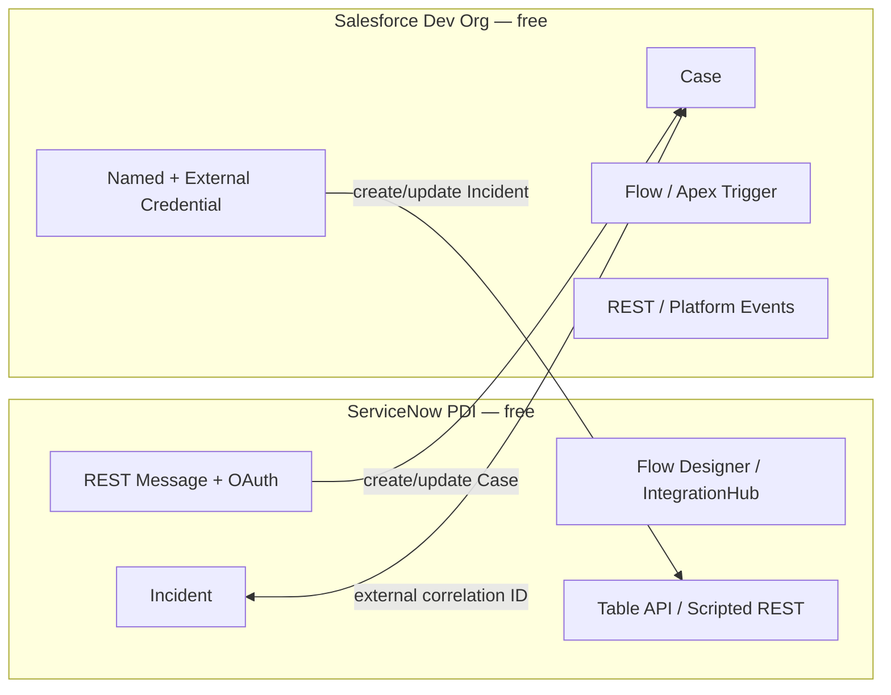

# ServiceNow ⇄ Salesforce — Free Integration Lab

Bond a **free ServiceNow Personal Developer Instance (PDI)** and a **free Salesforce Developer org** into a working proof-of-concept integration — using out-of-box workflows and custom REST/OAuth methods, with best-practice security throughout.

## Contents

1. [Overview, architecture & core concepts](docs/00-overview.md)
2. [Provision the free instances](docs/01-free-instances.md)
3. [Out-of-box integration methods](docs/02-out-of-box-integration.md)
4. [Level 1–2 — one-way sync (Postman → Table API → Salesforce Flow)](docs/03-level-1-and-2-one-way.md)
5. [Level 3 — Scripted REST API (more control)](docs/04-level-3-scripted-rest.md)
6. [Level 4 — bidirectional sync, field ownership & OAuth](docs/05-level-4-bidirectional.md)
7. [Security & best practices](docs/06-security-best-practices.md)
8. [Testing & validation](docs/07-testing-validation.md)
9. [Appendix — glossary, links, troubleshooting](docs/08-appendix.md)

## The idea in one diagram

## The progressive path

| Level | What you build | Direction | Difficulty |
|-------|----------------|-----------|------------|
| **1** | Postman/curl → ServiceNow Table API | One-way inbound | ⭐ |
| **2** | Salesforce Flow HTTP Callout → ServiceNow | One-way inbound (low-code) | ⭐⭐ |
| **3** | ServiceNow Scripted REST API (validation + correlation) | One-way inbound (custom) | ⭐⭐⭐ |
| **4** | Bidirectional Case ⇄ Incident with loop guard + OAuth | Two-way | ⭐⭐⭐⭐ |

Start with [1. Overview & core concepts](docs/00-overview.md), then provision the instances and climb the levels.
